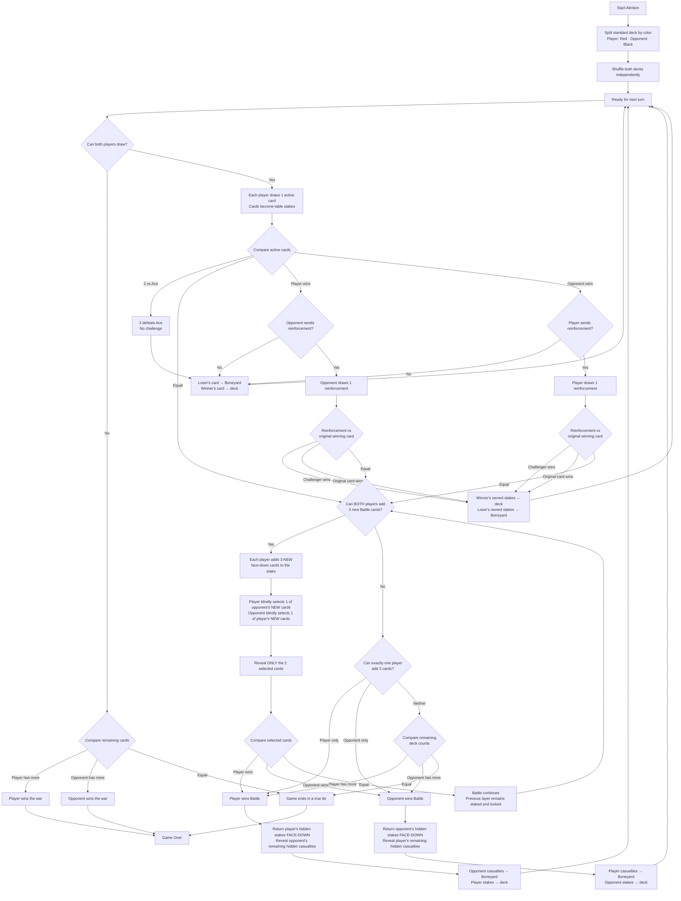

# War of Attrition

A two-player card game played against AI commanders, built as an Angular PWA, hosted on GitHub Pages at <https://cboler.github.io/war-of-attrition-game/>, and packaged for Google Play as a Trusted Web Activity (`android/`).

## Development

Requires Node 22 or 24 LTS (CI uses 24).

```bash
npm ci
npm start
```

Open `http://localhost:4200/`. `npm start` runs `scripts/set-env.js` first, which writes the environment files from `GOOGLE_CLIENT_ID` and `GA4_MEASUREMENT_ID` when they are set.

| Task | Command |
| --- | --- |
| Unit tests (watch) | `npm test` |
| Unit tests (single headless run, as CI) | `npm run test:ci` |
| Version-sync tests | `npm run test:version` |
| Production build into `docs/` | `npm run build:prod` |
| Play Store screenshots | `npm run screenshots:store` (see [`store-assets/screenshots/README.md`](store-assets/screenshots/README.md)) |
| Android unit tests | `cd android && ./gradlew testDebugUnitTest` |
| Android release bundle | `cd android && ./gradlew bundleRelease` (see [`developer-docs/play-store/README.md`](developer-docs/play-store/README.md)) |

Version numbers live in eleven files that must move together; use the `bump-version` skill in `.agents/skills/`.

## CI pipelines (`.github/workflows/`)

| Workflow | Runs on | What it does |
| --- | --- | --- |
| `deploy.yml` | Push and PR to `main` | Runs version-sync and Angular unit tests, then builds production and deploys to GitHub Pages (deploy only from `main`). |
| `android-checks.yml` | Push and PR touching `android/` | Android unit tests and release lint; no signing secrets needed. |
| `build-android-bundle.yml` | Manual run, or a published release tagged `v<package.json version>` | Checks the version matches `package.json`, runs Android unit tests, builds the signed release AAB, and uploads it with the R8 mapping. |
| `generate-store-screenshots.yml` | Manual run | Serves the production build and captures validated phone and tablet Play Store screenshots with Playwright. |
| `secret-scanning.yml` | Push, PR, weekly, manual | Gitleaks scan of the full history. |
| `copilot-setup-steps.yml` | Changes to itself, manual | Environment setup for the GitHub Copilot coding agent. |

## Attrition Game Flow



## Development Status & Documentation

War of Attrition has a feature-complete core and production initial passes for **Progressive Narrative Unveiling** and **Clash Visualizations / Battlefield Animations**. Every decisive card comparison currently summons a brief infantry skirmish while physical cards remain authoritative; this frequency is being evaluated in deployed play. Final release polish, closed-testing follow-up, and device validation remain.

- **Current Implementation Status**: [`.github/instructions/current-development-status.md`](.github/instructions/current-development-status.md) — Live status, active systems, and release priorities.
- **Rules & Specification**: [`.github/instructions/war-of-attrition-requirements.md`](.github/instructions/war-of-attrition-requirements.md) — Authoritative physical game rules and requirements.
- **Documentation Index**: [`.github/instructions/README.md`](.github/instructions/README.md) — Complete documentation hierarchy and development guides.
- **Private Narrative Canon**: [`developer-docs/narrative-canon.md`](developer-docs/narrative-canon.md) — Mont-Rouge chronology, commander dossiers, chapter disclosure, and source plan.
- **Narrative Disclosure Matrix**: [`developer-docs/narrative-disclosure-matrix.md`](developer-docs/narrative-disclosure-matrix.md) — Authored twelve-War sequence, Reveal Ledger, progressive dossier plan, transitions, callbacks, sources, audits, and Sprint 1 handoff.
- **Commander Voice Bible**: [`developer-docs/commander-voice-bible.md`](developer-docs/commander-voice-bible.md) — Final voice guidance and curated implementation-ready dialogue bank.
- **Play Store Release**: [`developer-docs/play-store/README.md`](developer-docs/play-store/README.md) — Android build, Play Console setup, Play Games bridge diagnostics; [`production-access-plan.md`](developer-docs/play-store/production-access-plan.md) — closed testing to production access.
- **Completed Sprints & Backlog**: [`developer-docs/future-gameplay-ideas.md`](developer-docs/future-gameplay-ideas.md) — implemented Narrative Sprint 1 and Clash Visualization V1 boundaries, release polish, and later candidates.
